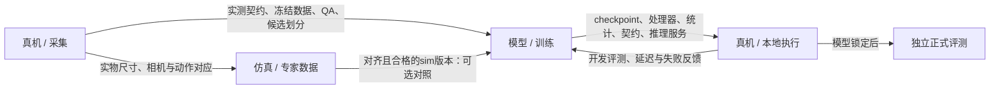

# 跨对话协作约定

更新：2026-10-17。用户计划用多个对话/agent分别推进真机采集、模型训练等工作。本约定按角色和交付物协调，不限定为两个对话；使用项目文件和Git交接，不依赖未落盘的聊天结论。本轮只整理规则，没有创建业务对话、启动训练或接管设备。

## 1. 分工与契约归属

| 角色 | 负责内容 | 主要交付 |
|---|---|---|
| 规划 / 整合 | 任务边界、里程碑、跨角色接口、共享状态和已验收改动整合；原规划对话可兼任仿真角色 | 本约定、进度/问题/开发日志、版本交接；不把自己当所有任务执行者 |
| 仿真 / 专家数据 | MuJoCo场景、物理专家、仿真数据、回放/导出与仿真契约适配 | `sim/`、仿真证据和数据卡；收到真实契约后适配 |
| 真机 / 采集 | 设备、相机、标定、遥操作、真实采集/QA；后续本地执行与真实评测 | 实测契约、冻结数据/候选划分、真实会话和评测证据；见[真机交接](项目记忆与真机交接.md) |
| 模型 / 训练 | 训练入口、参数审计、数据/处理器及train-only统计复核、G2训练侧与G4、checkpoint和模型推理服务 | 有效配置、冻结统计/处理器、可重载模型及推理证据；见[训练交接](项目记忆与模型训练交接.md) |
| 专项agent | 由某个主负责人拆出的版本核对、统计、参数审计、重载或只读审查等明确子任务 | 指定文件/证据与验收结果；不自行认领整个主线或重复启动共享作业 |

真实关节和相机契约以真机实测为准；仿真不得自行宣布已对齐。任务定义、归一化、相机名、关节顺序或控制频率发生变化时，先写明受影响的数据/模型版本，再适配；不能各留一套互相矛盾的有效配置。

当前角色由最新用户任务确定，同一对话可兼任角色，一个角色也可分派多个agent。分派时说明父角色、文件范围、交付物和验收条件；每个任务只指定一名主负责人。真机、训练对话读取各自交接后直接接手分配工作；需要更多角色时扩展登记，不预设对话总数。

## 2. 接口和可并行范围



- 真机侧做G0/G1时，训练侧可并行做本地接口/参数/处理器检查与配置准备，仿真侧可继续独立改进；都不因此把训练或真机阶段标完成。
- G2短训练依赖G1真实数据和契约验收；G4主训练依赖G3冻结版本、train-only统计和G2实测。训练侧产出模型后，真机侧负责本地执行，两侧共同验收完整G2。
- 真机侧可以在训练读取冻结v1时采集新v2，但不能改写训练正在读取的数据、划分或stats。仿真侧新生成数据也使用新版本，不直接追加到活动实验中。
- 训练侧负责统计来源/处理器与模型参数审计；真机侧提供实测契约、QA和候选分组，训练使用前复核冻结。正式测试布局不进入统计拟合、模型选择或反复补采。
- 训练只读录制观测进行模型验证不占机械臂；实际执行由真机侧安排。训练进程、模型服务和设备进程分别登记，不能因为训练结束就假设推理服务/设备已停止。

## 3. 当前交接登记

下表是一次性快照，**不是进程锁或设备空闲证明**。实际开始前重新查看；设备占用还需检查实际进程和现场状态。

| 角色 / 资源 | 本轮状态 | 下一步 |
|---|---|---|
| 原规划 / 仿真角色 | 仿真原型v1已验收；本轮扩充多角色协作 | 后续按任务统筹/仿真，不代替其他主负责人 |
| 真机对话 | 2026-10-17用户已在当前对话指定真机职责；已做CLI与指南核对，无设备进程启动；未登记thread id | 复用已有标定，现场核验设备后推进G0/G1 |
| 模型训练对话 / agent | 用户计划后续安排；本轮没有认领者或已运行的训练任务 | 先按训练交接开展本地准备，再接收G1数据 |
| 机械臂 / 相机 | 本对话没有启动设备进程；实际是否被其他程序占用未知 | 真机对话现场核验，运行前记录持有者/用途 |
| 云实例 / 推理服务 | 本项目尚未启动；没有已确认的服务地址 | 到G2/G5再核验和记录 |
| Git | 单仓库`<project-root>`，默认main；交接文档提交见历史 | 新任务开始先读状态和未提交改动 |

每项任务认领时填写：`task_id / 父角色 / 主负责人（对话或agent） / 状态 / 工作目录与分支 / 文件范围 / 上游版本 / 交付与验收 / 占用资源 / 下一步`。未认领就写“待认领”，不编造thread id、agent id或运行结果。

| 任务ID | 交接时状态 | 上游与验收 |
|---|---|---|
| SIM-v1 | 已验收；记录见数据卡 | 20条/12,177帧仿真原型，不代表真实对齐 |
| REAL-G0-G1 | 当前真机对话认领；准备阶段，尚未实测 | 设备/契约核验→10～20条试采及QA |
| TRAIN-PREP | 待认领；可先本地准备 | 实际接口、参数/统计/处理器审计方案、有效配置草案 |
| TRAIN-G2 | 等G1交付；未开始 | 真实batch更新、实际参数/梯度、保存重载、录制观测推理 |
| TRAIN-G4 | 等G3冻结及G2实测；未开始 | 主训练、恢复工件、checkpoint选择和部署交付包 |
| REAL-DEPLOY-EVAL | 等模型与接口；未开始 | 本地执行、开发修正、锁定后40次正式测试 |

会话原始明细分别写`outputs/real/`、`outputs/sim/`或`outputs/train/<experiment_id>/`。共享摘要由该任务主负责人汇总；子agent不各自改全局状态。上述待认领任务只是工作拆分，不表示本轮已创建/派发。

2026-10-17认领补充：`REAL-G0-G1 / 真机采集 / 当前用户指定的真机对话 / 准备中 / <project-root>, main / 操作指南及本轮共享状态摘要 / 当前项目与LeRobot版本 / G0实测后10～20条真实试采及QA / 本轮未占设备、未改共享环境 / 确认原标定文件、id与设备路径`。本轮有一个仅审查录制源码的只读子任务，无设备或文件写入权限分工；主对话串行整合共享文件。

## 4. 同一工作目录如何协作

**默认在同一checkout中串行修改与提交。** 多个对话/agent可独立分析，但同一文件、Git暂存区和共享环境不并行写入。

- 开始与提交前都查看`git status`和实际diff，只提交本轮明确拥有的文件；禁止`git add .`把其他对话的半成品一起提交。
- 不在另一个对话工作中切换共享目录的分支、reset、clean、stash、rebase或修改其暂存内容；遇到归属不明的改动先保留，再用文档/用户转述确认归属。
- 真正需要并行代码修改时，使用独立worktree/目录与分支，并记录各自路径。只新建分支不能隔离同一目录的未提交改动。
- 每个工作树仍使用同一外部LeRobot和可能共享的数据/硬件；代码隔离不会隔离设备、Python环境或云服务。数据和忽略的local配置须单独确认路径，不自动复制到新工作树。
- 校验后的完整改动形成小提交，记录提交号；在`main`整合时保留双方改动与真实证据，不覆盖对方进度。
- 用户已有的未跟踪目录也属于需要保留的内容。交接时存在`SO-ARM101开源6轴机械臂/`资料目录，本轮未审阅/修改/提交；不能当已验证驱动或直接打包进Git。

## 5. 设备、环境和服务独占

| 资源 | 约定 |
|---|---|
| leader/follower串口 | 同时只由真机对话安排的一个控制流程持有；标定、遥操作、录制、策略执行不并行 |
| top/wrist相机 | 开录前停止会抢占设备的独立预览；检查实际占用，不从文档表格推断空闲 |
| 校准文件、`configs/local.json` | 真机对话维护并记录版本/路径；不写入公共配置的猜测值，不让另一对话覆盖 |
| `.venv`、外部LeRobot | 不同时安装/升级依赖或修改框架；变更先记录版本、已有dirty状态和受影响流程 |
| 原始数据目录 | 每次会话使用唯一目录；resume/合并前核对版本和指令映射，不覆盖、删除或改写原始失败记录 |
| 云实例、端口、checkpoint | 记录实例用途、实际服务地址/端口、持有角色、代码/checkpoint和启动/停止状态，避免重复租卡或抢占服务 |
| 单个训练实验 | 一名主负责人管理GPU作业、实验目录、数据/统计快照和恢复状态；子agent不各跑一份同名作业，不并发覆盖checkpoint或有效配置 |

本轮只建立约定，设备实际停止/接管方式和运行条件由真机对话结合现场验证；不根据本文件直接发出机器人动作。

## 6. 共享文件的更新顺序

下列文件由完成该节点的对话作为当轮整合者更新，其他对话当轮不同时改写：

1. 原始证据先写到唯一会话/实验目录；分别填写[真实会话模板](../templates/real_session.md)或[训练实验模板](../templates/experiment.md)。
2. 真实契约和数据规范变更写入对应文档与配置，注明哪些候选值变成实测值；不会把所有`verified`一次设为true。
3. 同步更新`project_status.json`、`docs/进度看板.md`、`docs/开发日志.md`；读取最新内容后只改本轮节点，不整文件恢复旧快照。
4. 新问题先查看`docs/问题记录.md`的最新编号；复发更新原ISSUE，避免抢号。此步骤与共享状态更新串行进行。
5. 更新对应数据卡/环境摘要并提交；交接时给提交号、证据位置、未解决项和设备/服务状态。

状态词严格区分：计划、候选、已核验、已绕过、已完成；环境导入通过、数据可读、模型可训练和真机可执行分别验收。只有仿真通过时，不更新真实G0～G7为完成。

## 7. 真机 → 仿真/训练侧的交接最小包

```text
交接日期 / 提供角色 / 项目提交 / LeRobot提交与dirty状态：
数据版本 / 根目录 / episode清单 / 排除清单 / QA报告：
top/wrist名称、方向、实际图像设置与场景尺寸证据：
六维关节顺序、单位、目标语义、夹爪范围、标定版本、控制频率：
O_t/A_t采样关系、实际时间戳与丢帧情况：
session/layout分组、train/validation清单、隔离的正式测试布局：
统计来源episode与处理器；哪些统计尚未核验：
设备/服务当前状态 / 未解决问题 / 下一步最小动作：
```

仿真数据与真实数据分别保管，未对齐前不合并。即使只用训练episode加载数据，也要单独核验统计来源；现有仿真16/4清单和all-episode stats不能替代真实划分/统计。

## 8. 训练 → 真机侧的交接最小包

固定checkpoint路径/step/哈希、基础模型revision、项目/LeRobot版本、有效配置、数据/划分/统计版本、匹配的预处理/后处理与六维契约、新进程加载/录制观测推理报告、实际服务地址/端口与占用状态，以及预测chunk/执行窗口/推理步数。详细清单见[训练交接第7节](项目记忆与模型训练交接.md#7-训练--真机部署的交付包)。

真机侧接收后先按实际契约验证，再执行开发评测；不把“checkpoint已保存”直接标成“已部署成功”。正式模型锁定与40次测试按评测协议独立记录。
